 

<a href="https://imabf.github.io">imabf.github.io</a>

  

<h3><code>imabf@github ~ $ ./contributions.sh</code></h3>

  

<h3><code>imabf@github ~ $ neofetch</code></h3>

  

<h3><code>imabf@github ~ $ cat stack.txt</code></h3>

  

<h3><code>imabf@github ~ $ ls projects/</code></h3>

| Project | What it is |
| --- | --- |
| 🛡️ [**ResiWare**](https://github.com/imabf/resiware) | Senior project, built as a team: an AI-assisted ransomware defense system that helps detect and respond to ransomware threats in an organization's network. Evaluated on simulated security events, where it successfully flagged ransomware activity |
| ⚙️ **Software Engineering Project** | A complete system taken from requirements to implementation, with UML and use cases, built by an Agile team |
| 🌐 **Full-Stack Web App** | Node.js front end and back end with user authentication and RESTful APIs |
| 🔑 **Password Security Testing** | Mini project simulating a brute-force attack in a controlled environment, with the findings and password-policy improvements reported |

 

<h3><code>imabf@github ~ $ ./contact.sh</code></h3>

📫 <a href="mailto:abfmashhadani@gmail.com">abfmashhadani@gmail.com</a>

